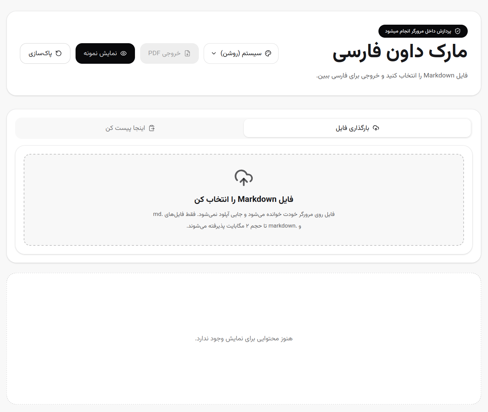

# Persian Markdown Preview · پیش‌نمایش Markdown فارسی

یک ابزار استاتیک و سبک برای نمایش فایل‌های Markdown با تجربه‌ی خواندن بهتر برای فارسی و راست‌چین (RTL). همه‌ی پردازش داخل مرورگر انجام می‌شود و هیچ فایلی به سرور ارسال نمی‌شود.

> A privacy-friendly, in-browser Markdown viewer with first-class RTL/Persian support, extended syntax, and Mermaid diagrams. Everything runs client-side — no file ever leaves your browser.



## ویژگی‌ها

- **سه روش ورودی**: بارگذاری فایل `.md`/`.markdown`، پیست کردن مستقیم متن، یا لینک عمومی با پارامتر `?url=`
- **راست‌چین واقعی**: متن فارسی به‌صورت `rtl` و بلوک‌های کد به‌صورت `ltr` نمایش داده می‌شوند
- **اصلاح دوجهته (bidi)**: فلش‌های «منجر می‌شود به» در متن فارسی آینه و با RLM مهار می‌شوند تا عبارت‌های لاتینِ دو طرفشان به یک جزیره‌ی چپ‌به‌راست نچسبند؛ داخل بلوک کد، جهت پایه‌ی هر خط ثابت `ltr` است تا نمودارهای ASCII با برچسب فارسی برعکس نشوند
- **۳۶ پوسته**: هر ۳۵ تم داخلی daisyUI به‌علاوه‌ی حالت «هماهنگ با سیستم»
- **سازگار با موبایل**: خواندن فایل بدون وابستگی به `FileReader` (پشتیبانی از مرورگرهای داخل‌برنامه‌ای اندروید/iOS)
- **خروجی PDF**: دکمه‌ی «خروجی PDF» سند را با همان ظاهر پیش‌نمایش روی کاغذ A4 می‌سازد؛ متن فارسی برداری و قابل انتخاب می‌ماند، لینک‌ها کلیک‌شدنی‌اند و نمودارهای Mermaid هم چاپ می‌شوند
- **پردازش کاملاً داخل مرورگر**: بدون آپلود واقعی فایل به سرور؛ تنها درخواست خودکار صفحه، خواندن تعداد ستاره‌های همین مخزن از GitHub API است (بدون هیچ داده‌ای از سند و بدون referrer، با کش یک‌ساعته در `localStorage`)
- **امنیت**: خروجی HTML با DOMPurify پاک‌سازی می‌شود تا ریسک XSS کاهش یابد
- فونت Vazirmatn به‌صورت self-host از npm
- محدودیت حجم فایل تا ۲ مگابایت برای جلوگیری از کندی مرورگر
- آماده برای deploy روی Cloudflare Pages، Netlify، Vercel یا GitHub Pages

## سینتکس‌های پشتیبانی‌شده

علاوه بر Markdown پایه، این موارد از [سینتکس گسترده](https://www.markdownguide.org/extended-syntax/) پشتیبانی می‌شوند:

- جدول‌ها، بلوک کد با تشخیص زبان (highlight.js)
- فهرست کارها `- [ ]` / `- [x]`
- پانویس `[^1]` و شناسه‌ی خودکار سرتیترها (برای anchor و فهرست مطالب، حتی با متن فارسی)
- کال‌اوت‌های سبک GitHub: `> [!NOTE]`, `[!TIP]`, `[!IMPORTANT]`, `[!WARNING]`, `[!CAUTION]`
- های‌لایت `==متن==`، زیرنویس `H~2~O`، بالانویس `E=mc^2^`
- خط‌خورده `~~متن~~` و فهرست تعریف (`Term` / `: definition`)
- ایموجی با شورت‌کد مثل `:rocket:`
- زیرخط `<ins>`، تصویر با اندازه/کپشن (`<figure>`)
- **نمودارهای Mermaid** (دایره‌ای/pie، فلوچارت، گانت و ...) که فقط هنگام نیاز به‌صورت تنبل بارگذاری می‌شوند:

  ````markdown
  ```mermaid
  pie title سهم زبان‌ها
      "فارسی" : 70
      "انگلیسی" : 30
  ```
  ````

## پوسته‌ها

هر ۳۵ تم داخلی [daisyUI](https://daisyui.com/docs/themes/) پشتیبانی می‌شود، به‌علاوه‌ی گزینه‌ی **هماهنگ با سیستم** که پیش‌فرض است و از `prefers-color-scheme` پیروی می‌کند. انتخاب کاربر در `localStorage` می‌ماند و پیش از اولین رنگ‌آمیزی صفحه اعمال می‌شود، پس پرشِ تم دیده نمی‌شود.

انتخاب تم روی `data-theme` عنصر `<html>` می‌نشیند و همه‌ی رنگ‌های برنامه و سند از توکن‌های همان تم می‌آیند (`base-100/200/300`، `base-content`، `primary`، `secondary`، `accent`، `neutral`، `info`، `success`، `warning`، `error`). هیچ رنگ ثابتی در CSS نمانده، پس تم جدید بدون قانون اضافه کار می‌کند.

سه جا CSS به‌تنهایی کافی نبود:

- **برجسته‌سازی کد**: به‌جای پالت ثابت highlight.js، کلاس‌های توکن روی رنگ‌های معنایی همان تم نگاشته شده‌اند، پس بلوک کد در هر ۳۵ تم به سند تعلق دارد.
- **بلوک کد**: در تم روشن تیره می‌ماند (همان ظاهری که کاربر می‌شناسد) و در تم تیره `base-300` می‌گیرد تا یک پله زیر صفحه بنشیند، نه یک تخته‌ی سفید.
- **Mermaid**: پالت را داخل SVG می‌پزد، پس با تغییر تم نمودارها دوباره رسم می‌شوند (`data-scheme` روی `<html>` سیگنال این کار است).

**چاپ همیشه پالت کاغذ دارد.** هر تمی که روی صفحه باشد، خروجی PDF مرکب روی سفید است — تم تیره‌ی چاپ‌شده ناخواناست و تم رنگی جوهر هدر می‌دهد.

## خروجی PDF

دکمه‌ی «خروجی PDF» در سربرگ، پنجره‌ی چاپ مرورگر را باز می‌کند و استایل چاپ اختصاصی ([`src/styles/print.css`](src/styles/print.css)) دیزاین پیش‌نمایش را روی A4 بازسازی می‌کند:

- هدر و پنل ورودی حذف و کارت پیش‌نمایش تمام‌عرض می‌شود؛ سربرگی به سند اضافه نمی‌شود و اولین تیتر خودِ سند عنوان آن است
- نام پیشنهادی فایل PDF همان نام فایل Markdown است و برای متن پیست‌شده، اولین تیتر سند
- جدول‌ها قاب گِرد خودشان را نگه می‌دارند، سرستون در هر صفحه تکرار می‌شود و سرستونِ کاملاً خالی حذف می‌شود
- بلوک‌های کد گِردی و فاصله‌گذاری سایت را حفظ می‌کنند ولی به پالت روشنِ همان تم سوییچ می‌شوند
- چک‌باکس‌های فهرست کار دوباره با کادر و تیک کشیده می‌شوند تا مستقل از تنظیمات چاپ خوانا بمانند
- تیتر هرگز ته صفحه تنها نمی‌ماند، سطر جدول و بلوک کد وسط نمی‌شکند و پاراگراف‌ها یتیم/بیوه نمی‌شوند

**تنظیمات پنجره‌ی چاپ.** پیش از باز شدن پنجره، یک راهنمای کوتاه سه گزینه‌ای نشان داده می‌شود (قابل خاموش‌کردن دائمی): مقصد روی **Save as PDF**، روشن‌کردن **Background graphics** برای چاپ پس‌زمینه‌ی کال‌اوت‌ها و جدول‌ها، و خاموش‌کردن **Headers and footers** تا آدرس و تاریخِ مرورگر روی برگه‌ها نیفتد. سند بدون هیچ‌کدام از این‌ها هم کاملاً خوانا می‌ماند.

**مرورگر را برای خروجی مهم بگیرید.** موتور PDF فایرفاکس (cairo) اموجی‌های رنگی را به تصویر تبدیل می‌کند و متن فارسی را به‌شکل Arabic Presentation Forms (به‌همراه چند کاراکتر `�`) در لایه‌ی متنی می‌نویسد؛ نتیجه این است که اموجی‌ها در بزرگ‌نمایی نرم دیده می‌شوند و متن PDF قابل کپی و جست‌وجو نیست. روی همان سند، Chrome هر هفت اموجی و کل متن فارسی را به‌صورت متن واقعی نگه می‌دارد. اگر فایرفاکس تشخیص داده شود، دیالوگ خروجی این را هشدار می‌دهد.

از رندر مبتنی بر canvas (مثل html2canvas) استفاده نشده چون متن فارسی را به تصویر تبدیل می‌کند و شکل حروف و قابلیت جست‌وجو از بین می‌رود.

## نصب

```bash
npm install
```

## اجرای لوکال

```bash
npm run dev
```

## ساخت نسخه production

```bash
npm run build
```

خروجی داخل پوشه `dist` ساخته می‌شود.

## پیشنهاد Deploy روی Cloudflare Pages

```txt
Framework preset: Vite
Build command: npm run build
Build output directory: dist
```

## نکته امنیتی

این پروژه فایل را به سرور ارسال نمی‌کند. با این حال، چون Markdown می‌تواند HTML تولید کند، خروجی با DOMPurify (به‌همراه پروفایل SVG برای آیکون‌ها و نمودارها) sanitize می‌شود. اگر در آینده قابلیت ذخیره، اشتراک‌گذاری لینک یا API اضافه شد، باید اعتبارسنجی و sanitize سمت سرور هم اضافه شود.

## مشارکت

Issue و Pull Request خوش‌آمد است. پیش از ارسال PR، از سبز بودن این دو مطمئن شوید:

```bash
npm run lint
npm run build
```

## لایسنس

این پروژه تحت لایسنس [MIT](LICENSE) منتشر شده است.
